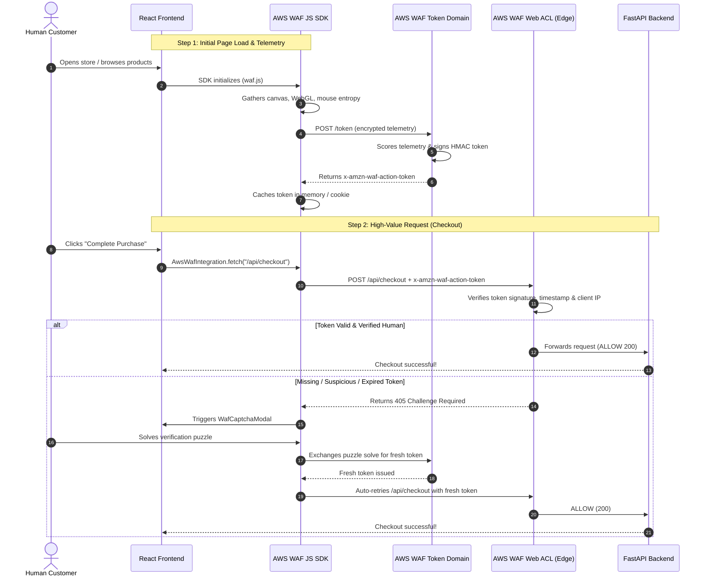

# AWS WAF Bot Control & JavaScript SDK: Deep Dive & Architecture Guide

A comprehensive architectural explanation of why **WAF alone** is insufficient against modern automated threats, what the **AWS WAF JavaScript Application Integration SDK** actually does, and how combining both solves bot problems without ruining the human user experience.

---

## 📌 Table of Contents
1. [The Core Dilemma: WAF Alone vs. WAF + JS SDK](#1-the-core-dilemma-waf-alone-vs-waf--js-sdk)
2. [What Problems Exist When Using WAF Alone?](#2-what-problems-exist-when-using-waf-alone)
3. [What Does the AWS WAF JavaScript SDK Actually Do?](#3-what-does-the-aws-waf-javascript-sdk-actually-do)
4. [End-to-End Architectural Flow](#4-end-to-end-architectural-flow)
5. [Side-by-Side Comparison: WAF Web ACL vs. JS SDK](#5-side-by-side-comparison-waf-web-acl-vs-js-sdk)
6. [How This Project Implements Both](#6-how-this-project-implements-both)
7. [Key Takeaways for Production Deployment](#7-key-takeaways-for-production-deployment)

---

## 1. The Core Dilemma: WAF Alone vs. WAF + JS SDK

In traditional web architectures, security teams place a **Web Application Firewall (WAF)** at the network edge (AWS CloudFront, Application Load Balancer, or API Gateway). 

While WAF alone is great at stopping SQL injection, Cross-Site Scripting (XSS), and rudimentary volumetric attacks, **it has a fundamental blind spot against modern bots**.

> **The Core Difference in One Sentence:**  
> **WAF alone** inspects *what the HTTP network packet claims* (which any bot can forge), whereas the **JavaScript SDK** inspects *the physical device and browser runtime executing the code* (which bots cannot easily fake).

---

## 2. What Problems Exist When Using WAF Alone?

When an application relies exclusively on WAF rules at the edge, four critical problems emerge:

### Problem 1: The "Stealth Headless Browser" Disguise
Modern scalpers, scrapers, and account takeover bots no longer use simplistic tools like `curl` or basic Python `requests`. They use headless automation frameworks like **Puppeteer, Playwright, or Selenium** coupled with browser patchers (such as `puppeteer-extra-plugin-stealth` or `Undetected-ChromeDriver`).
- They send **100% authentic HTTP headers** (matching real Chrome/Safari browser header ordering and `Sec-CH-UA` client hints).
- To a WAF inspecting incoming HTTP packets at the edge, **a stealth bot request looks identical to a genuine customer request**.

```
[ Headless Puppeteer Bot ] ──► "User-Agent: Chrome/120..." ──► [ WAF ALONE ] ──► ALLOWED (200)
[ Legitimate Customer   ] ──► "User-Agent: Chrome/120..." ──► [ WAF ALONE ] ──► ALLOWED (200)
                                                                     ▲
                                                        WAF CANNOT DISTINGUISH
                                                        BETWEEN THEM AT THE EDGE
```

### Problem 2: Residential Proxy Networks Defeat Rate Limiting
WAF rate-limiting rules (e.g., maximum 300 requests per 5 minutes per IP) work well against single-source floods. However, modern bot operators route their traffic through **distributed residential proxy pools** (millions of legitimate home ISP IP addresses):
- Every single bot request originates from a distinct IP address.
- Each IP only makes 1 or 2 requests.
- **Result:** WAF rate-limiting counters never trigger, and the bot snipes your entire inventory in milliseconds.

### Problem 3: The False-Positive Trap (Blocking Real Humans)
If you configure WAF alone to be strict enough to catch stealth bots (e.g., blocking any aggressive activity or unknown header variations):
- Real users behind corporate proxies, university campuses, or mobile carrier CGNAT (where thousands of humans share one public IP) get blocked.
- Legitimate customers encounter false-positive error pages, abandoning their carts and losing sales.

### Problem 4: Single-Page Application (SPA) UX Crash
When a traditional WAF blocks or challenges a suspicious request:
- It returns an HTML CAPTCHA or 403 HTML page.
- In a modern React/Vue Single-Page Application, an asynchronous API call (e.g., `fetch('/api/checkout')`) expects a **JSON response**.
- Receiving an HTML document causes JSON parsing to fail (`SyntaxError: Unexpected token '<'`), leading to application errors, lost form state, and broken checkout flows.

---

## 3. What Does the AWS WAF JavaScript SDK Actually Do?

The AWS WAF JS SDK (`waf.js`) runs **inside the client browser runtime**. It operates as an active sensor and gatekeeper through five core responsibilities:

```
┌────────────────────────────────────────────────────────────────────────┐
│                   AWS WAF JAVASCRIPT SDK IN ACTION                     │
├────────────────────────────────┬───────────────────────────────────────┤
│ 1. Passive Device Telemetry    │ Analyzes GPU, Canvas, WebGL, Audio    │
├────────────────────────────────┼───────────────────────────────────────┤
│ 2. Anti-Automation Probing     │ Inspects navigator.webdriver, CDP     │
├────────────────────────────────┼───────────────────────────────────────┤
│ 3. Human Behavioral Entropy    │ Tracks mouse trajectory, touch, keys  │
├────────────────────────────────┼───────────────────────────────────────┤
│ 4. Token Acquisition & Refresh │ Exchanges telemetry for signed token  │
├────────────────────────────────┼───────────────────────────────────────┤
│ 5. Transparent Fetch & Retries │ Attaches token & handles CAPTCHA 405  │
└────────────────────────────────┴───────────────────────────────────────┘
```

### 1. Passive Hardware & Browser Telemetry
The SDK inspects deep environment attributes that a headless script or proxy cannot easily forge:
- **Canvas Rendering Entropy**: Renders an invisible image to a hidden HTML `<canvas>` element and hashes the raw pixel data. Variations in GPU architecture, OS font rasterization, and graphics drivers create a unique hardware signature.
- **WebGL Capabilities**: Probes WebGL vendor, renderer strings, and supported extensions to verify real GPU hardware exists.
- **Screen & Audio Metrics**: Evaluates screen color depth, sub-pixel rendering, and AudioContext sample rates.

### 2. Probing for Automation & Headless Flags
The SDK actively tests for automation footprints:
- Probing whether `navigator.webdriver === true`.
- Testing for Chrome DevTools Protocol (CDP) runtime artifacts (e.g., `window.__puppeteer_evaluation_script__`, `cdc_adoQpoasnfa76pfcZLmcfl_Array`).
- Checking prototype tampering in `navigator.plugins` or `navigator.languages`.

### 3. Human Behavioral Entropy
While the user browses the storefront, the SDK passively monitors natural physical interactions:
- Mouse velocity and acceleration curves (real humans do not move in straight lines with instantaneous velocity).
- Touch events, scroll gestures, and typing cadence.
- Time spent on page before triggering high-value actions.

### 4. Acquiring and Rotating the Signed Action Token
- The SDK bundles the collected telemetry, encrypts it, and sends it to the AWS WAF Token Domain (`POST /token`).
- AWS WAF verifies the telemetry score. If the client passes, AWS signs and issues an **`x-amzn-waf-action-token`**.
- The token is cryptographically bound to:
  - **The client's IP address** (preventing token theft and replay from another computer).
  - **Issue timestamp & 15-minute TTL** (preventing replay of stale tokens).
- The SDK manages the token lifecycle, automatically requesting a fresh token before expiration without disrupting the user.

### 5. Transparent Request Wrapping & Challenge Resolution
- **Transparent Attachment**: Using `AwsWafIntegration.fetch()`, the SDK automatically attaches the token to request headers or cookies.
- **Frictionless Human Experience**: 99% of legitimate users are verified **invisibly**; they never see a challenge puzzle.
- **Graceful CAPTCHA & Auto-Retry**: If a sensitive action (like checkout) requires proof-of-work, WAF returns a `405 Challenge`. The SDK intercepts this response, opens an integrated CAPTCHA modal inside the SPA, collects the user's puzzle solution, retrieves a new token, and **automatically retries the pending request** without page refresh or data loss.

---

## 4. End-to-End Architectural Flow



---

## 5. Side-by-Side Comparison: WAF Web ACL vs. JS SDK

| Dimension | AWS WAF Web ACL | AWS WAF JavaScript SDK |
| :--- | :--- | :--- |
| **Execution Environment** | **Server / Edge** (CloudFront, ALB, API Gateway) | **Client Browser** (Runs in user's browser runtime) |
| **Primary Responsibility** | **The Gatekeeper / Judge** (Enforces rules, drops attacks) | **The Sensor / Reporter** (Proves client authenticity) |
| **Information Inspected** | HTTP packet, headers, IP address, request rates | GPU shaders, canvas rendering, DOM objects, mouse curves |
| **Vulnerability to Spoofing**| High (Headers and IP addresses are easily forged or rotated)| Very Low (Deep browser execution mechanics are hard to fake) |
| **User Experience Impact** | Binary: either allows or abruptly drops/blocks connections | Invisible background telemetry; seamless SPA CAPTCHA retry |
| **Can It Work Alone?** | Blocks basic bots (`curl`, `scrapy`), but blind to stealth bots | Cannot block anything alone (a bot could just ignore the SDK) |

> **Key Rule of Thumb:**  
> The **JS SDK** produces the cryptographic proof of humanity.  
> The **WAF Web ACL** verifies the proof and enforces the access decision.

---

## 6. How This Project Implements Both

This repository contains a full-scale implementation of this architecture:

### 1. The Client Integration (`/frontend`)
- [`wafIntegration.ts`](file:///home/ubuntu/ecommers-application-with-waf-bot-control-and-monitering/frontend/src/services/wafIntegration.ts):
  - Emulates and wraps `window.AwsWafIntegration`.
  - Captures passive canvas entropy (`generateCanvasEntropy()`) and mouse movement counters.
  - Implements `acquireToken()` with fallback between the live AWS Token Domain and the local simulator.
  - Wraps API calls via `fetch()` to inject `x-amzn-waf-action-token`.
- [`WafCaptchaModal.tsx`](file:///home/ubuntu/ecommers-application-with-waf-bot-control-and-monitering/frontend/src/components/WafCaptchaModal.tsx):
  - Handles the `405 Challenge` interception, provides an interactive proof-of-work puzzle slider, and silently retries pending requests upon completion.
- [`Navbar.tsx`](file:///home/ubuntu/ecommers-application-with-waf-bot-control-and-monitering/frontend/src/components/Navbar.tsx):
  - Displays the live token diagnostic badge (`waf_tok_...`) with a token-drop button to let you simulate missing-token challenge flows manually.

### 2. The Enforcement Middleware (`/backend`)
- [`waf_middleware.py`](file:///home/ubuntu/ecommers-application-with-waf-bot-control-and-monitering/backend/app/middleware/waf_middleware.py):
  - Evaluates all incoming HTTP requests before they reach API controllers.
  - Returns `403 BLOCK` for scrapers and scalpers.
  - Returns `405 CHALLENGE` for sensitive mutations lacking a verified token.
  - Broadcasts live events to the monitoring SOC dashboard via WebSockets.
- [`waf_service.py`](file:///home/ubuntu/ecommers-application-with-waf-bot-control-and-monitering/backend/app/services/waf_service.py):
  - Generates HMAC-SHA256 signed action tokens: `waf_tok_{token_id}:{timestamp}:{ip}:{hash}_{signature}`.
  - Cryptographically validates token authenticity, expiration, and IP binding.

### 3. Production Infrastructure (`/infrastructure`)
- [`aws-waf-bot-control.yaml`](file:///home/ubuntu/ecommers-application-with-waf-bot-control-and-monitering/infrastructure/aws-waf-bot-control.yaml):
  - CloudFormation template deploying an AWS WAFv2 WebACL with:
    - `AWSManagedRulesBotControlRuleSet` with `InspectionLevel: TARGETED`.
    - `AWSManagedRulesATPRuleSet` (Account Takeover Prevention) on `/api/auth/login`.
    - Configured `TokenDomains` for client SDK integration.

---

## 7. Key Takeaways for Production Deployment

1. **Enable Targeted Bot Control Tier**: Common Tier only inspects headers; Targeted Tier enables token domains, challenge responses, and telemetry analysis.
2. **Include the Script Tag in `index.html`**:
   ```html
   <script type="text/javascript" src="https://<token-domain>/<key>/waf.js" defer></script>
   ```
3. **Use `AwsWafIntegration.fetch` for Critical Endpoints**: Protect high-value endpoints (e.g. `/api/checkout`, `/api/auth/login`, `/api/cart`) by wrapping their fetch calls so tokens are always attached and challenges are handled automatically.
4. **Never Rely on Client-Side Checks Alone**: Always pair the client SDK with the server-side WAF Web ACL to ensure requests cannot bypass verification.
